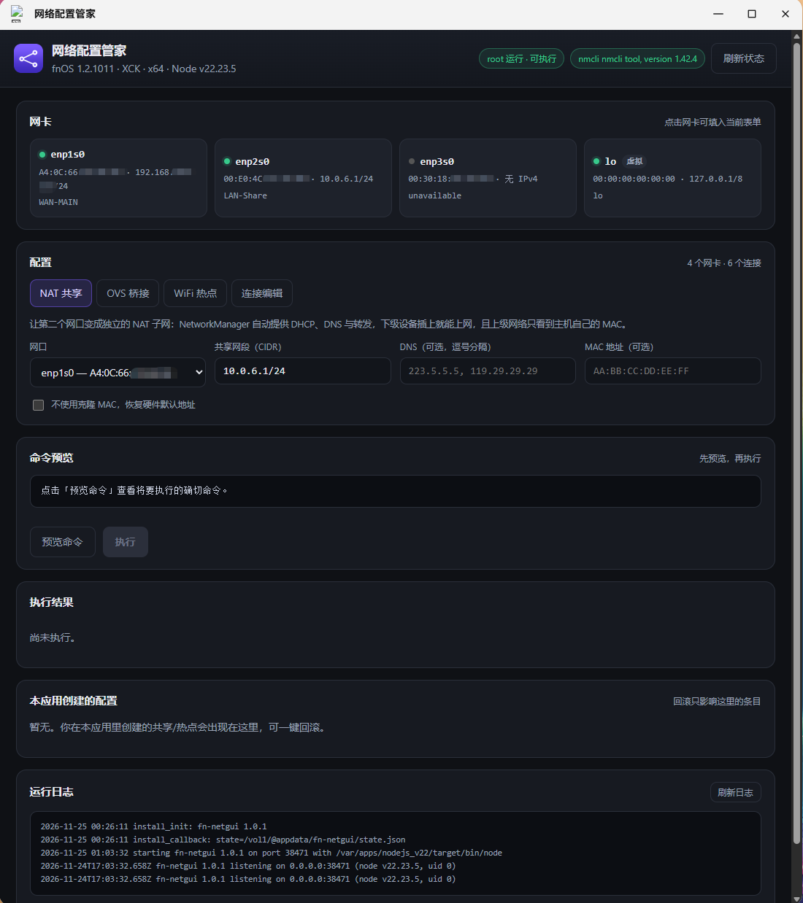

# 网络配置管家 · fn-netgui

[](https://github.com/zgyhbcz/fn-netgui/actions/workflows/ci.yml)
[](https://github.com/zgyhbcz/fn-netgui/releases)
[](LICENSE)
[](https://www.fnnas.com)
[](https://nodejs.org)

飞牛 fnOS 的第三方应用（.fpk）：在桌面里把**第二个网口 / 无线网卡**共享给下级设备，并完成静态 IP、网关、DNS、MAC 地址的一站式配置。所有命令**先预览、再执行**，随时可一键回滚。

> 面向的场景：NAS 只有一个网口接外网，想把另一个网口当 LAN 用；但所在网络「一个 MAC 只能绑定一个 IP」，不能做二层桥接；又不想每次改动都 SSH 进终端敲 `nmcli`。

## 界面



*实机截图：fnOS 1.2.1011 / x86，应用以 root 运行，nmcli 1.42.4 —— 网卡卡片、四种模式、命令预览与执行结果、回滚区、运行日志*

---

## 功能

| 模式 | 作用 | 关键命令 |
| --- | --- | --- |
| **NAT 共享**（推荐） | 第二个网口变成独立子网，NetworkManager 自动提供 DHCP/DNS/NAT，下级设备插上即上网；上级网络只看到主机自己的 MAC | `nmcli connection add … ipv4.method shared` |
| **OVS 桥接** | 把网口作为 OVS 网桥端口，NAS 变成二层交换机 | `ovs-vsctl add-port <bridge> <iface>` |
| **WiFi 热点** | 无线网卡变 AP，手机/平板直接连接 | `nmcli device wifi hotspot …` |
| **连接编辑** | 改本应用创建的连接：静态 IP、网关、DNS、克隆 MAC | `nmcli connection modify …` |

通用能力：

- **命令预览**：执行前显示将要运行的确切命令（含引号），可复制到终端手工执行。
- **输入格式化**：MAC 自动补 `:`（支持智能退格）、IP 自动补 `.`、中文标点自动转半角、DNS 逗号分隔。
- **执行结果逐条回显**：成功/失败/跳过 + stdout/stderr。
- **回滚**：只回滚本应用创建的连接与桥接端口，不碰系统原有配置。
- **运行日志**：`/var/apps/fn-netgui/var/netgui.log`，界面内可查看。

---

## 目录结构

```
fn-netgui/
├── manifest                     # 应用身份证（appname/端口/依赖/图标入口）
├── ICON.PNG · ICON_256.PNG      # 64×64 / 256×256 应用图标
├── config/
│   ├── privilege                # run-as=root（nmcli 需要特权）
│   └── resource                 # 未声明额外能力
├── cmd/
│   ├── main                     # start / stop / status / restart
│   ├── install_init             # 检查 nmcli / ip
│   ├── install_callback         # 初始化 state.json
│   ├── upgrade_init|callback    # 状态备份 / 幂等重建
│   ├── config_init|callback     # 空实现
│   └── uninstall_init|callback  # 停服务；可选清理本应用连接
├── wizard/
│   └── uninstall                # 卸载时选择「保留 / 删除」本应用的连接
├── app/
│   ├── server/                  # Node 后端（零 npm 依赖）
│   │   ├── server.js            # HTTP 服务、鉴权、静态资源、API
│   │   └── lib/
│   │       ├── validate.js      # 入参校验（网口/IP/MAC/SSID…）
│   │       ├── plans.js         # 纯函数：payload → argv 计划
│   │       ├── nm.js            # nmcli / ip / ovs-vsctl 只读查询
│   │       └── shell.js         # execFile 封装（永不拼 shell）
│   └── ui/                      # GUI（原生 JS，无框架）
│       ├── index.html · app.js · style.css
│       ├── config               # 桌面 iframe 入口（fn-netgui.main）
│       └── images/icon_{64,128,256}.png   # 下划线命名，对应 {0} 占位符
├── tests/plans.test.js          # 23 条纯函数测试
├── docs/screenshot.png          # 实机运行截图（README 界面预览）
├── tools/
│   ├── build_fpk.py             # 免 fnpack 的打包器（校验 + 确定性 tar）
│   ├── verify_fpk.py            # 校验 .fpk 结构 / 权限位 / checksum（CI 同款）
│   ├── check_ui.py              # GUI 选择器一致性检查
│   ├── publish.py               # 用 GitHub API 建仓库并上传（绕开 443 不稳）
│   └── make_icons.py            # 图标生成（Pillow）
└── dist/                        # 构建产物，已被 .gitignore 忽略；发布时挂 Release
```

安装后的运行时目录（由 fnOS 创建）：

```
/var/apps/fn-netgui/
├── server/  ui/  cmd/  config/   # 来自 app.tgz 与 fpk
├── var/                          # TRIM_PKGVAR：state.json、netgui.log
├── etc/  home/  tmp/  target/    # 系统管理
```

---

## 权限与安全模型（请先读）

`config/privilege` 使用 **`run-as: root`**。原因很直接：`nmcli connection modify`、`ovs-vsctl` 都需要 root，没有特权就无法配置网络。官方文档也建议只有确实需要特权时才用 root 模式；**这类应用适合手动安装（侧载）自用，不适合提交应用中心**（商店要求企业开发者资质）。

在 root 前提下，服务端做了这些收敛：

| 措施 | 说明 |
| --- | --- |
| 只允许内网访问 | 非回环/私网地址直接 403（`NETGUI_ALLOW_ANY_PEER=1` 可关闭，不建议） |
| CSRF 防护 | 所有写接口必须带 `X-NetGUI-Request: 1` 自定义头，并校验 `Origin` |
| 不拼 shell | 全部走 `execFile(bin, argv)`，参数经严格白名单校验；网口名、连接名、IP、MAC、SSID 都过正则 |
| 只动自己的连接 | 连接名统一前缀 `netgui-`；回滚只接受 `netgui-*`，编辑也只允许本应用创建的连接 |
| 请求体上限 | 64 KiB，JSON 对象，解析失败即拒 |
| 路径穿越防护 | 静态资源解析后必须落在 `app/ui/` 内，仅白名单后缀 |

> 若你希望完全不用 root：把 `config/privilege` 改成 `"run-as": "package"`，应用会以**只读模式**运行 —— 能预览命令、复制到终端用 `sudo` 手工执行，但界面上的「执行」会被禁用并给出提示。

---

## 典型使用流程

1. 安装后打开「网络配置管家」，确认顶部徽标为 `root 运行 · 可执行`。
2. 在「网卡」区点选要做 LAN 的网口（如 `enp2s0`），它会自动填入当前表单。
3. 选择 **NAT 共享**：
   - 共享网段：`10.0.6.1/24`（不要与现有网段冲突，界面会告警）
   - DNS：可留空（默认跟随主机）
   - MAC：填入网络允许绑定的地址，如 `AA:BB:CC:DD:EE:FF`（输入时自动补冒号）
4. 点「预览命令」核对，再点「执行」。
5. 验证（在 NAS 上或界面日志里）：

```bash
ip -4 addr show enp2s0          # 应看到 10.0.6.1/24 与设定的 MAC
nmcli -f ipv4.method,ipv4.addresses connection show netgui-shared-enp2s0
```

下层设备接上 `enp2s0` 后应自动获得 `10.0.6.x`，网关与 DNS 均为 `10.0.6.1`：

```bash
ping 10.0.6.1 && ping 223.5.5.5 && ping baidu.com
```

---

## 构建

### 方式 A：仓库自带打包器（无需 fnpack）

```bash
python3 tools/build_fpk.py                     # → dist/fn-netgui_1.0.1_x86.fpk（读 manifest 的 platform）
python3 tools/build_fpk.py --platform arm      # → dist/fn-netgui_1.0.1_arm.fpk
python3 tools/build_fpk.py --version 1.0.2     # 覆盖版本号
```

> **`platform` 只能是 `x86` / `arm` / `loongarch` / `risc-v`**。写成 `all`（官方文档里有这个值）会被 appcenter 判为 **「应用约束检查失败」** 而装不上——`fnpack` 原话是 *must be one of x86, arm, loongarch, or risc-v*。打包器与校验器现在都会拦这个值。

它会先做结构校验（manifest 必填字段、`platform` 取值、图标尺寸、JSON 合法性、cmd 脚本 shebang 与 LF 换行、入口 ID 前缀），再生成确定性 tar（固定 mtime、uid/gid、`cmd/*` 为 0755），并把 `md5(app.tgz)` 写入 manifest 的 `checksum`。

### 方式 B：官方 fnpack

```bash
fnpack build -d fn-netgui      # 产物：fn-netgui-1.0.1.fpk
```

### 产物结构

```
fn-netgui_1.0.1_x86.fpk   (tar.gz)
├── manifest        # checksum = md5(app.tgz)
├── app.tgz         # server/ + ui/
├── cmd/ config/ wizard/
├── ICON.PNG  ICON_256.PNG
```

---

## 安装与测试

```bash
# 应用中心 → 手动安装 → 选择与本机架构匹配的 .fpk（x86 或 arm）
# 或命令行：
appcenter-cli install-fpk fn-netgui_1.0.1_x86.fpk
appcenter-cli list
appcenter-cli start fn-netgui
```

- 首次安装会自动拉起依赖 `nodejs_v22`（manifest `install_dep_apps`），无需手工装 Node。
- 桌面出现「网络配置管家」图标，点击在桌面窗口（iframe）内打开。
- 卸载时可选择是否连带删除本应用创建的连接。
- 装错了架构会直接报 **「应用约束检查失败」**：`x86` 包用于 Intel/AMD（N100/N150 等迷你主机），`arm` 包用于 ARM 设备（晶晨/瑞芯微盒子）。

### 本地开发（无 fnOS 也能跑起来）

```bash
node app/server/server.js          # 默认 0.0.0.0:38471
# Windows/macOS 上：非 root → 只读模式，仅预览可用
```

### 单元测试

```bash
node tests/plans.test.js           # 23 passed
python3 tools/check_ui.py          # GUI 静态一致性（HTML id ↔ app.js 选择器）
```

`tests/plans.test.js` 覆盖：CIDR/MAC/子网重叠、四种模式的命令生成、非法输入与命令注入拒绝、回滚白名单、未知 action。
`tools/check_ui.py` 覆盖：脚本引用的 id 是否都存在、tab/panel 是否一一对应、`data-format` 是否有对应处理器、`collectPayload` 读取的字段是否都在 HTML 里。

---

## 已知限制与假设

1. **未在真机 fnOS 上验证**（本仓库在无 NAS 环境构建）。交付前请按上面「典型使用流程」逐项验证。
2. `desktop_uidir = ui` 解析到 `app/ui`：依据 fnpack 模板与 [10router 的实测 fpk](https://github.com/techysy/10router/tree/main/fnos-packaging) 的目录布局。若图标不出现在桌面，把 `app/ui` 复制到包根目录 `ui/` 重新打包即可（两种布局都保留时以根目录为准）。
3. OVS 端口由 `ovs-vsctl` 直接添加，NetworkManager 可能把它显示为 external；撤销同样走 `ovs-vsctl del-port`。
4. WiFi 热点需要网卡与驱动支持 AP 模式；5GHz 还受 DFS 信道限制，失败请改用 2.4GHz。
5. **按架构分发**：包内没有架构相关二进制（Node 运行时由 `nodejs_v22` 提供），但 appcenter 的约束检查要求 manifest 的 `platform` 与设备架构一致，所以分别产出 `x86` 与 `arm` 两个包；`all` 会被拒绝（1.0.1 修复）。
6. NAT 共享依赖 NetworkManager 的 `shared` 模式（自动拉起 dnsmasq）；若系统改过 NM 配置，需自行确认 `ip_forward` 与转发规则。

---

## 排错

```bash
bash /var/apps/fn-netgui/cmd/main status      # 运行状态（0 运行 / 3 未运行）
tail -n 100 /var/apps/fn-netgui/var/netgui.log
fuser 38471/tcp                               # 端口占用
nmcli device status                           # 网卡与连接状态
ovs-vsctl show                                # 网桥与端口
```

常见问题：

| 现象 | 处理 |
| --- | --- |
| 安装时弹「**应用约束检查失败**」 | manifest 的 `platform` 非法或与设备架构不符（`all` 必定失败）。看清设备架构（系统设置 → 关于 / `uname -m`），装对应包：`x86_64` → `_x86.fpk`，`aarch64` → `_arm.fpk` |
| 界面提示「非 root · 仅预览」 | `config/privilege` 未被应用，或安装时用了旧包；确认 `run-as: root` 后重启应用 |
| 预览正常、执行报 `nmcli: command not found` | fnOS 网络未由 NetworkManager 管理（少见），需改用 CLI 手工操作 |
| 下级设备拿不到 IP | 检查父网段是否冲突、`ip_forward`、上级路由 DHCP 干扰；先试 `10.0.6.1/24` 这类偏僻网段 |
| 桥接后网络异常 | 你的网络可能按 MAC 做绑定：改用 NAT 共享并设置克隆 MAC |
